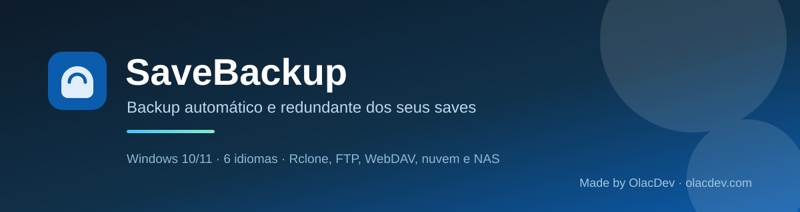

# SaveBackup



**Backup automático, local e redundante dos saves dos seus jogos no Windows.**
Um executável único, sem instalador, sem telemetria e sem dependências externas para o backup local.

[](https://github.com/ArthurAlvDev/savebackup/actions/workflows/build.yml)
[](LICENSE)
[](https://www.python.org/)
[](#requisitos)

---

## Por que existe

Saves de jogos costumam ficar espalhados em `Documents`, `Documents\My Games`, `AppData` e pastas próprias de cada loja. Perder um save significa perder dezenas de horas — e a maioria dos jogos não tem backup nativo.

O SaveBackup observa as pastas escolhidas, compacta tudo em `.zip` com data e hora, replica para quantos destinos você quiser (outro disco, NAS, pasta de nuvem, FTP ou WebDAV) e mantém apenas as versões mais recentes.

## Recursos

- **Backup local automático** por intervalo configurável, com cópia redundante em vários destinos.
- **Compactação atômica**: grava em `.part` e renomeia ao final; se o processo cair, nenhum `.zip` fica corrompido.
- **Limpeza de restos**: arquivos `.part` de execuções interrompidas são removidos automaticamente.
- **Nuvem opcional**: Rclone (+70 provedores), pasta local de nuvem (OneDrive, Google Drive, Dropbox, Mega), FTP/FTPS, WebDAV (Nextcloud, ownCloud, Box) e caminho de rede SMB.
- **Rotação de backups**: mantém os últimos *N* arquivos em cada destino.
- **Bandeja do sistema**: backup manual pelo menu do ícone, sem abrir a janela.
- **Início com o Windows** (opção única, sem tarefas agendadas escondidas).
- **Instância única**: uma segunda execução apenas traz a janela existente para frente.
- **Interface em 6 idiomas**: português (BR), inglês, espanhol, francês, alemão e italiano.
- **100% local por padrão**: nenhum dado sai da máquina sem você configurar um destino.

## Requisitos

- Windows 10 ou 11 (64 bits).
- Para usar o código-fonte: Python 3.10 ou superior, com Tkinter (incluído no instalador oficial).

## Instalação

**Executável (recomendado)**

1. Baixe `SaveBackup.exe` na página de [Releases](https://github.com/ArthurAlvDev/savebackup/releases).
2. Coloque em uma pasta de sua preferência e execute. Não requer instalação.

Opcionalmente, crie um arquivo vazio chamado `portable.txt` ao lado do executável para que a configuração seja gravada na própria pasta, em vez de `%APPDATA%\SaveBackup`.

**Código-fonte**

```bash
git clone https://github.com/ArthurAlvDev/savebackup.git
cd savebackup
python main.py
```

Para iniciar direto na bandeja:

```bash
python main.py --minimized
```

Para conferir a versão:

```bash
python main.py --version
```

## Como usar

1. **Pastas para backup**: adicione as pastas de saves dos jogos.
2. **Destinos do backup local**: escolha um ou mais diretórios, o intervalo e quantos backups manter.
3. **Nuvem / Backup externo** (opcional): selecione o provedor, configure o acesso e use **Testar conexão**.
4. Deixe o programa na bandeja. Os backups seguem sozinhos.

Acompanhe cada operação no **Registro de Atividades**, com data e hora.

## Compilar o executável

```bat
build.bat
```

O script instala o PyInstaller, roda os testes e gera `dist\SaveBackup.exe` a partir de `SaveBackup.spec`, com ícone e metadados de versão embutidos.

O mesmo build roda no GitHub Actions em `.github/workflows/build.yml`; tags `v*` anexam o executável a um release.

## Testes

```bash
python -m unittest discover -s tests -v
```

Cobrem compactação atômica, exclusão de destinos dentro da origem, rotação, limpeza de arquivos parciais, migração de configuração e integridade das traduções.

## Estrutura

```text
savebackup/
├── main.py                     # Ponto de entrada, instância única, --version
├── SaveBackup.spec             # Build PyInstaller (onefile, sem console)
├── version_info.txt            # Metadados do .exe
├── build.bat                   # Testes + build
├── locales/                    # Traduções (pt, en, es, fr, de, it)
├── assets/logo.ico.b64         # Ícone do aplicativo (base64)
├── tools/restore_icon.py       # Restaura logo.ico antes do build
├── src/
│   ├── config/                 # Constantes e persistência de configuração
│   ├── core/                   # Compactação e retenção
│   ├── i18n/                   # Carregamento de traduções e fallback
│   ├── platform/               # Autostart, bandeja Win32, instância única
│   ├── storage/                # Rclone, FTP, WebDAV, nuvem local, rede
│   └── ui/                     # Janela Tkinter e componentes
├── tests/                      # Testes automatizados
└── docs/                       # Arte do repositório
```

## Privacidade

As credenciais de FTP/WebDAV ficam apenas em `%APPDATA%\SaveBackup\config.json`, em texto simples, no seu computador. O programa não possui telemetria, não acessa a rede por conta própria e só envia backups para destinos que você configurar.

Recomendação: não use este arquivo de configuração em máquinas compartilhadas.

## Idiomas

| Idioma | Código | Arquivo |
| --- | --- | --- |
| Português (BR) | `pt` | `locales/pt.json` |
| English | `en` | `locales/en.json` |
| Español | `es` | `locales/es.json` |
| Français | `fr` | `locales/fr.json` |
| Deutsch | `de` | `locales/de.json` |
| Italiano | `it` | `locales/it.json` |

Novos idiomas são adicionados sem tocar no código: crie `locales/<código>.json` com as chaves de `en.json` e registre o nome em `locales/_metadata.json`.

## Contribuição

Leia [CONTRIBUTING.md](CONTRIBUTING.md). Alterações de comportamento devem vir com teste.

## Licença

[MIT](LICENSE) © 2026 OlacDev.

---

<p align="center">
  Made by <strong>OlacDev</strong> — <a href="https://olacdev.com/">olacdev.com</a>
</p>
